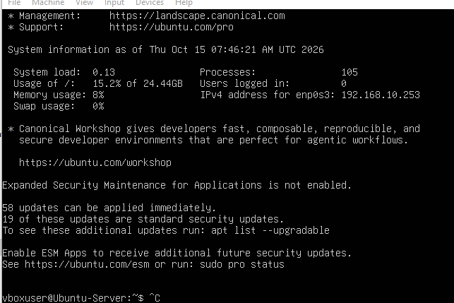
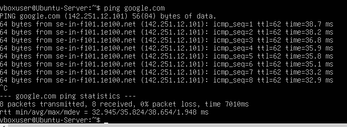
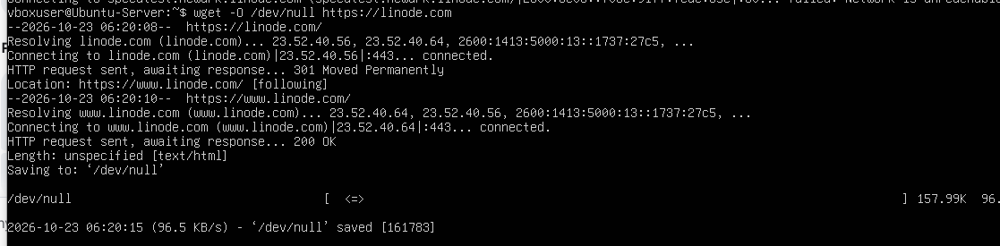

# Ubuntu Server (CLI) Network Integration with MikroTik

Dokumentasi implementasi, administrasi jaringan, dan pengujian konektivitas pada **Ubuntu Server 22.04 LTS (CLI)** yang terintegrasi ke dalam infrastruktur jaringan virtual **MikroTik RouterOS**.

> Proyek mandiri untuk latihan administrasi sistem Linux, konfigurasi antarmuka jaringan CLI, dan verifikasi performa jaringan end-to-end.

---

## 📌 Ringkasan Sistem & Jaringan

| Parameter               | Konfigurasi / Spesifikasi                    |
| ----------------------- | -------------------------------------------- |
| **Sistem Operasi**      | Ubuntu Server 22.04 LTS (Non-GUI / Headless) |
| **Virtualisasi**        | Oracle VirtualBox                            |
| **Antarmuka Jaringan**  | `enp0s3` (Internal Network: `lan-kantor`)    |
| **Metode Alokasi IP**   | DHCP Client (otomatis dari MikroTik Gateway) |
| **Alamat IP Diperoleh** | `192.168.10.253/24`                          |
| **Default Gateway**     | `192.168.10.1` (MikroTik ether2)             |
| **DNS Resolver**        | `8.8.8.8` (Google Public DNS via DHCP)       |

---

## ⚙️ Ruang Lingkup Konfigurasi & Pengujian

1. **Konfigurasi Antarmuka Virtual:** Menghubungkan adapter jaringan virtual Ubuntu ke segmen switch internal yang sama dengan gateway router.
2. **Verifikasi Alokasi DHCP:** Memastikan network stack Ubuntu berhasil meminta dan menyewa IP lease dari pool router secara otomatis.
3. **Uji Resolusi Nama Domain (DNS):** Memverifikasi kemampuan sistem dalam menerjemahkan nama domain (FQDN) ke alamat IP publik.
4. **Benchmark Throughput:** Menguji stabilitas transfer data unduhan melalui protokol HTTP menggunakan utility `wget`.

---

## 🧪 Hasil Pengujian & Verifikasi

### 1. Verifikasi Alokasi IP Address

Sistem berhasil mendapatkan konfigurasi IP dinamis dan gateway dari router MikroTik:



### 2. Uji Konektivitas & Resolusi DNS

Pengujian konektivitas menggunakan perintah ICMP ping ke domain `google.com` dengan tingkat keberhasilan 100%:



```text
14 packets transmitted, 14 received, 0% packet loss, time 13022ms
rtt min/avg/max/mdev = 30.947/34.043/39.927/2.841 ms
```

### 3. Pengujian Throughput & Download

Pengujian transfer paket data besar dari server eksternal menggunakan utility CLI:



---

## 📌 Catatan Analisis & Troubleshooting Linux

1. **Manajemen DNS Resolver di Ubuntu:** Mengamati fungsi `systemd-resolved` dalam menangani query nama domain lokal maupun publik.
2. **Pentingnya FQDN pada CLI:** Menemukan bahwa perintah `ping google` menghasilkan error `Temporary failure in name resolution` karena resolver membutuhkan nama domain lengkap (`google.com`).
3. **Analisis Case-Sensitivity HTTP:** Mengamati respon web server di mana `10mb.zip` mengembalikan kode status `404 Not Found`, sedangkan `10MB.zip` berhasil diunduh dengan kode status `200 OK`.

---

## 👤 Penulis

- **Nama:** Naufal Naazhir Arkaan
- **Email:** naufaljpr9@gmail.com

---
